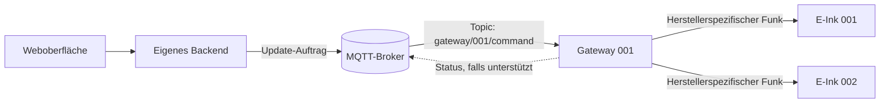
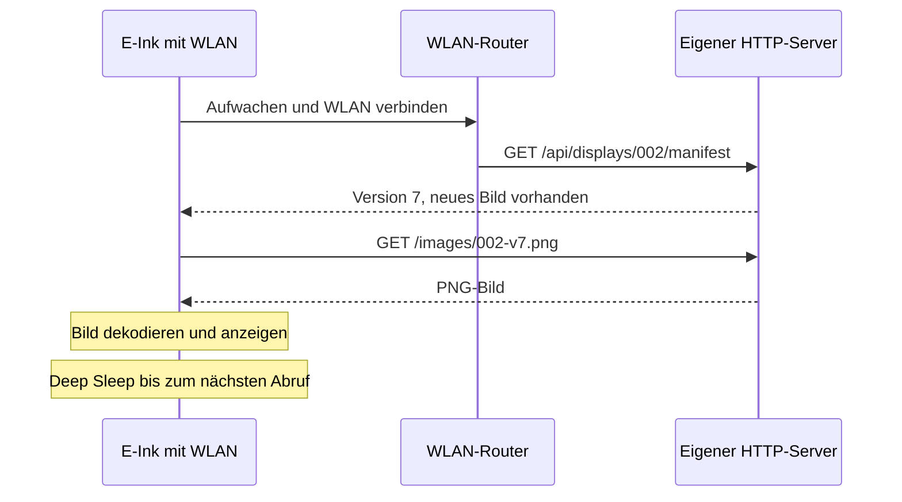

# E-Ink Tischkarte – Kommunikationslabor

**Zwei Wege, ein Ziel:** Eine digitale Tischkarte bekommt ein neues Motiv – entweder über ein **MQTT-Gateway** oder direkt über **WLAN**. Dieses Testprojekt macht beide Wege auch ohne Hardware sichtbar.

> **Status:** Vollständig implementiert und lauffähig! Lokaler Simulator für beide Kommunikationspfade mit interaktivem Web-Dashboard, Bildgenerierung, eingebettetem MQTT-Broker/Mosquitto-Support, Simulatoren für Gateway 001 und WLAN Display 002 sowie ESP32/Inkplate Firmware.

## Auf einen Blick

| | A · MQTT-Gateway | B · Direktes WLAN |
|---|---|---|
| **Bildlich gesprochen** | Ein Verteiler nimmt Aufträge an und funkt sie an die Schilder. | Jedes Schild holt sich sein Bild selbst. |
| **Weg** | Server → MQTT-Broker → Gateway → Funk → Display | Display → WLAN → HTTP-Server → Bilddownload |
| **Zusätzliche Hardware** | Gateway erforderlich | Kein Gateway erforderlich |
| **Eigene Firmware auf dem Display** | Häufig nicht nötig bzw. nicht frei änderbar | Möglich, z. B. mit ESP32/Inkplate |
| **Abhängigkeiten** | Gateway-Firmware, Funkprotokoll, Hersteller-API | Eigene Firmware, WLAN-Infrastruktur, Bibliotheken |
| **Batterie** | Abhängig von Funktechnik und Display | Deep Sleep möglich; WLAN-Aufwachen kostet Energie |
| **Sofortige Updates** | Möglich, abhängig vom Funk-/Gateway-System | Bei Deep Sleep erst beim nächsten Aufwachen; dauerhaftes WLAN kostet Energie |
| **150–200 Displays** | Gateway-Reichweite, Kapazität und Gebäude prüfen | WLAN-Abdeckung, AP-Kapazität und gleichzeitige Abrufe prüfen |
| **Kosten** | Gateway-Kosten **plus** Displays | WLAN-fähige Displays, **kein** Gateway; Stückpreis kann höher sein |

**Wichtig:** MQTT und WLAN sind keine direkten Gegensätze. MQTT ist ein Nachrichtenprotokoll, WLAN eine Funknetztechnik. In diesem Labor vergleichen wir konkret **Gateway-Funkarchitektur** mit **direktem HTTP-Abruf über WLAN**.

## Die beiden Wege als Schaubild

### A · MQTT-Gateway: „Der Server gibt einen Auftrag“



**Beispiel:** In der Weboberfläche wird „Heute: Kürbissuppe“ eingetragen. Das Backend veröffentlicht einen Auftrag. Das Gateway empfängt ihn und stößt die Aktualisierung des gewünschten Displays an.

**Stärken:** Ein Gateway bündelt viele Displays; je nach Funktechnik energiesparend; zentrale Steuerung.

**Schwächen:** Zusätzliches Gerät; Reichweite und maximale Displayzahl müssen geprüft werden; die Hersteller-Firmware kann eine Abhängigkeit bleiben.

### B · WLAN: „Das Display fragt selbst nach“



**Stärken:** Kein Gateway; offene, selbst programmierbare Firmware; direkte Anbindung an das eigene Backend.

**Schwächen:** WLAN-Energiebedarf; Aktualisierung im Schlaf nicht sofort; Netzwerkzugang für jedes Gerät; Bildformat und Dekodierung müssen zur Hardware passen.

## Was sieht man in der Demo?

Die geplante Weboberfläche zeigt zwei digitale Tischkarten nebeneinander:

```text
┌─────────────────────────────────────────────────────────────────────┐
│  E-INK LAB                     2 Displays · Lokale Simulation       │
├───────────────────────────────┬─────────────────────────────────────┤
│  DISPLAY 001 · MQTT            │  DISPLAY 002 · WLAN                 │
│  ┌─────────────────────────┐  │  ┌─────────────────────────┐        │
│  │     HEUTE EMPFOHLEN     │  │  │     HEUTE EMPFOHLEN     │        │
│  │      Kürbissuppe       │  │  │      Kürbissuppe       │        │
│  │         6,90 €          │  │  │         6,90 €          │        │
│  └─────────────────────────┘  │  └─────────────────────────┘        │
│  Status: Gateway verbunden     │  Status: Schläft / nächster Abruf  │
│  [Update senden]               │  [Jetzt aufwecken]                 │
├───────────────────────────────┴─────────────────────────────────────┤
│  NACHRICHTEN-LOG                                                   │
│  12:00:01  Backend: Bildversion 7 erstellt                          │
│  12:00:02  MQTT: Auftrag an gateway/001/command                     │
│  12:00:03  Gateway: Auftrag empfangen                               │
│  12:00:05  Simulation: Display 001 aktualisiert                     │
│  12:15:00  WLAN-Display 002: GET /manifest                          │
│  12:15:01  WLAN-Display 002: GET /images/002-v7.png                 │
│  12:15:03  Simulation: Display 002 aktualisiert                     │
└─────────────────────────────────────────────────────────────────────┘
```

**Interaktion:** Text oder Bild ändern → Update auslösen → Nachrichtenweg im Log verfolgen → Verzögerung und Status vergleichen. Der Simulator soll auch Fehlerfälle zeigen: Gateway offline, WLAN nicht erreichbar, unveränderte Bildversion.

## Beispielnachrichten

**MQTT-Auftrag (frei gewähltes Demoformat):**

Topic: `gateway/001/command`

```json
{
  "device_id": "display_001",
  "action": "update",
  "image_url": "http://localhost:8000/images/menu-v7.png",
  "version": 7
}
```

**WLAN-Antwort auf die Versionsabfrage:**

```json
{
  "device_id": "display_002",
  "version": 7,
  "image_url": "/images/menu-v7.png"
}
```

**Achtung:** `localhost` funktioniert nur auf demselben Rechner. Echte Geräte brauchen die erreichbare Server-IP oder einen DNS-Namen. Außerdem bedeutet eine MQTT-Zustellbestätigung nicht automatisch, dass das E-Ink-Bild erfolgreich aktualisiert wurde.

## Vorgeschlagene Projektstruktur

```text
eink-prototype/
├── README.md
├── backend/
│   ├── server.py              # HTTP-API und Demo-Steuerung
│   ├── image_generator.py     # Motiv als Bild rendern
│   └── requirements.txt
├── mqtt/
│   ├── gateway_simulator.py   # Gateway-Verhalten nachstellen
│   ├── send_command.py        # MQTT-Auftrag senden
│   └── monitor.py             # MQTT-Nachrichten beobachten
├── wifi/
│   ├── display_simulator.py   # WLAN-Polling und Sleep simulieren
│   └── inkplate_firmware.ino  # Später: echte ESP32-Firmware
├── frontend/
│   └── ...                    # Dashboard mit zwei Displays
└── images/
    └── menu.png
```

## Geplanter Ablauf für den MVP

1. **Ohne Hardware:** Backend, MQTT-Broker und beide Simulatoren lokal starten.
2. **Live-Vergleich:** Ein Motiv an beide Displays senden und Ereignisse protokollieren.
3. **Fehlerfälle:** Offline-Verhalten, Wiederverbindung, erneute Zustellung und Versionsprüfung testen.
4. **Mit Hardware:** WLAN-Simulator durch Inkplate-Firmware ersetzen; MQTT-Simulator gegen echte Gateway-API testen.
5. **Pilot:** Funkabdeckung, Batterielaufzeit, Aktualisierungsdauer und Gesamtkosten für 150–200 Displays messen.

### Technische Bausteine

- **Backend:** Python 3.9+, FastAPI, Uvicorn
- **MQTT-Broker:** Eclipse Mosquitto (oder der automatisch startende Python MiniBroker auf Port 1883)
- **MQTT-Client:** Paho MQTT
- **Bildgenerierung:** Pillow (hochauflösendes E-Ink Layout mit optionaler 1-Bit Floyd-Steinberg Rasterung)
- **Frontend:** Interaktives HTML5/CSS/JavaScript Dashboard mit WebSocket-Live-Protokoll und EPD-Refresheffekten
- **WLAN-Hardwareoption:** ESP32-basiertes Inkplate 10 (`wifi/inkplate_firmware.ino`)
- **Automatisierte Tests:** Pytest

---

## Schnellanleitung & Startbefehle

### 1. Labor-Komplettstart (Ein Befehl)

Startet das Backend, den MQTT-Broker, das Web-Dashboard und beide Simulatoren (Gateway 001 & WLAN Display 002):

```bash
./run.sh
```

Oder alternativ direkt mit Python:

```bash
source .venv/bin/activate
python3 start.py
```

Das Web-Dashboard ist anschließend erreichbar unter:
👉 **[http://localhost:8000](http://localhost:8000)**

### 2. Automatisierte Tests ausführen

```bash
source .venv/bin/activate
PYTHONPATH=. pytest -v
```

### 3. Einzelwerkzeuge & CLI-Nutzung

- **MQTT-Monitor (Live-Feed im Terminal):**
  ```bash
  python mqtt/monitor.py --broker 127.0.0.1 --port 1883
  ```

- **MQTT-Auftrag manuell per CLI absenden:**
  ```bash
  python mqtt/send_command.py --device display_001 --version 7 --image http://localhost:8000/images/menu-v7.png
  ```

- **Bildgenerator manuell ausführen:**
  ```bash
  python backend/image_generator.py --title "Kürbissuppe" --price "6,90 €" --output images/menu.png
  ```

- **Gateway-Simulator separat starten:**
  ```bash
  python mqtt/gateway_simulator.py --broker 127.0.0.1 --port 1883
  ```

- **WLAN-Display-Simulator separat starten:**
  ```bash
  python wifi/display_simulator.py --server http://127.0.0.1:8000 --interval 15
  ```

## Entscheidung für YUPSALE

**Noch nicht allein nach der Anzahl der Komponenten entscheiden.** Ein WLAN-Display spart zwar das Gateway, kann aber pro Display teurer sein und andere Anforderungen an die Stromversorgung haben. Eine Gateway-Lösung kann bei vielen Displays wirtschaftlicher sein, bringt jedoch zusätzliche Herstellerabhängigkeiten.

Für die Auswahl messen wir bei beiden Varianten:

| Kriterium | Wie wir es überprüfen |
|---|---|
| Gesamtkosten | 200 × Displaypreis + Gateways + Netzwerkinfrastruktur + Betrieb |
| Laufzeit | Reale Messung bei festgelegter Update-Häufigkeit |
| Zuverlässigkeit | 100 wiederholte Updates inklusive Verbindungsabbrüchen |
| Aktualisierungszeit | Zeit von „Speichern“ bis zum sichtbaren neuen Bild |
| Unabhängigkeit | Kann das System ohne Hersteller-Cloud betrieben und aktualisiert werden? |
| Wartung | Firmware-Updates, Geräteverwaltung und Fehlerdiagnose |

**Vorläufige Empfehlung:** Beide Kommunikationswege im Simulator entwickeln. Für maximale Softwarekontrolle ist die direkte WLAN-Variante attraktiv; für einen großen, batteriebetriebenen Rollout kann die Gateway-Variante Vorteile haben. Die Entscheidung fällt nach einem Hardwaretest, nicht anhand einer pauschalen Siegerwertung.
